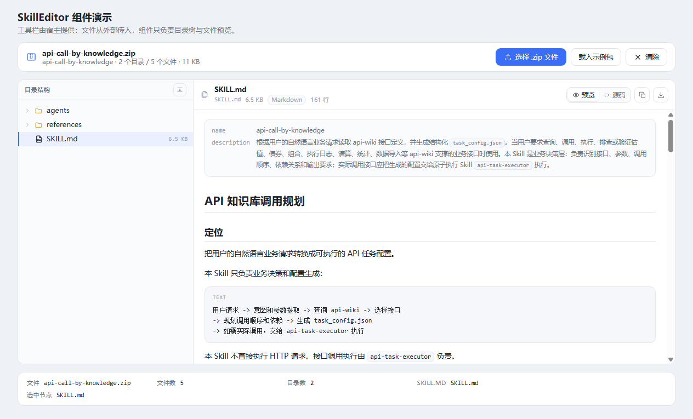
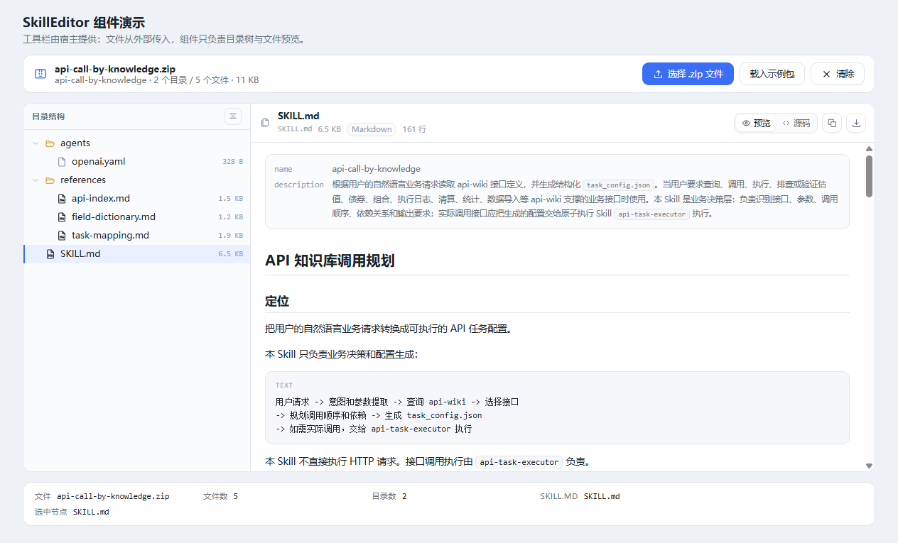
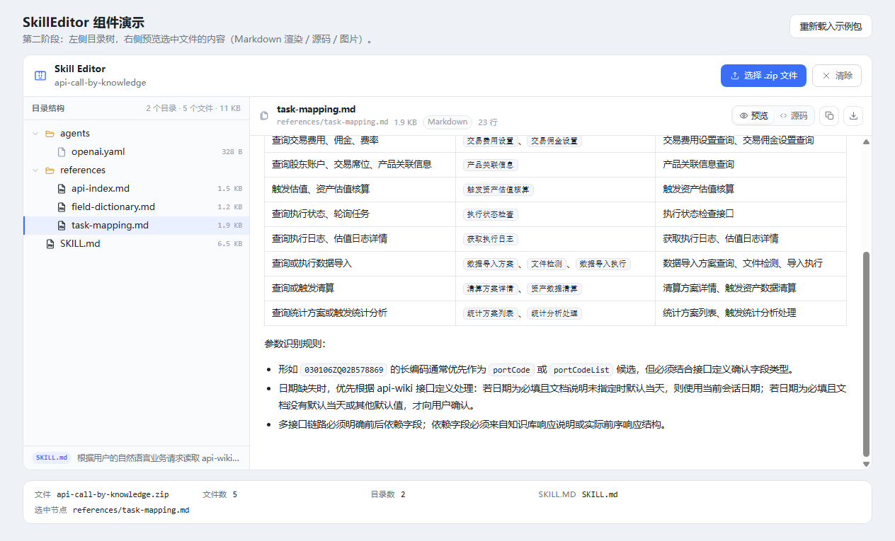
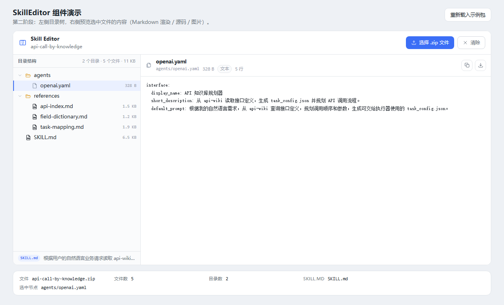
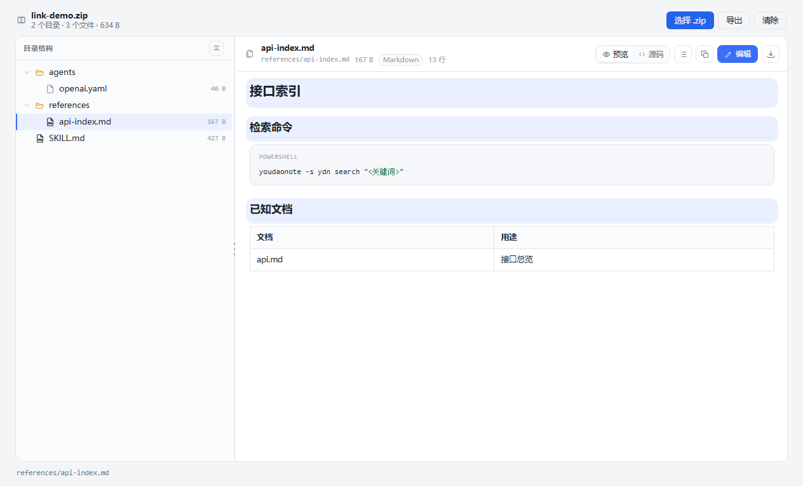
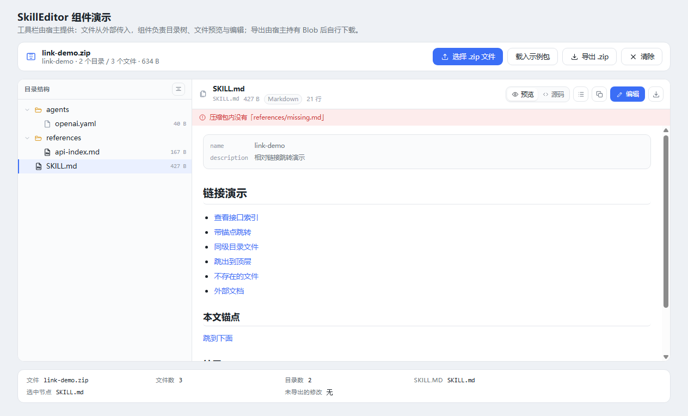
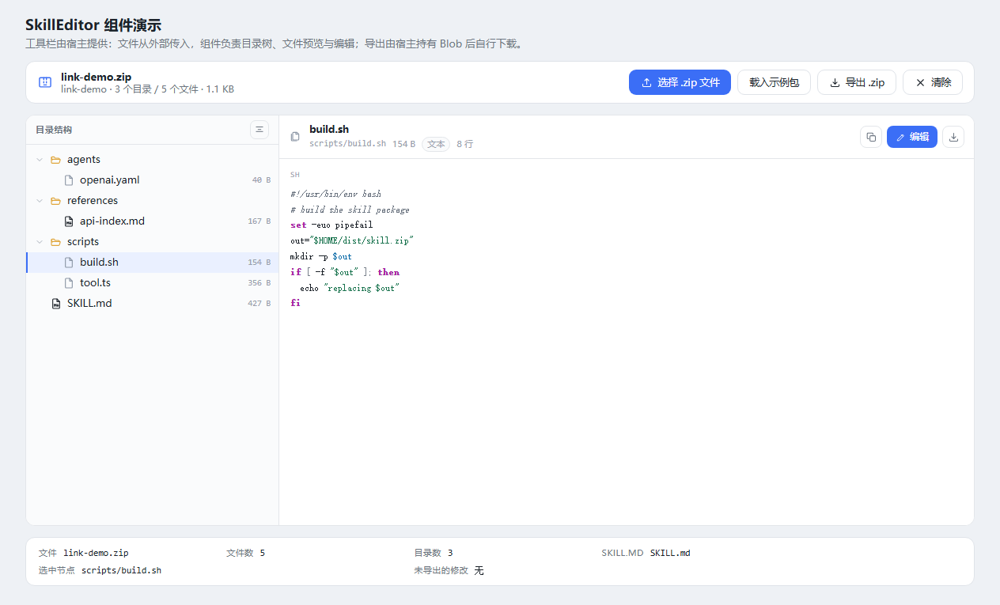

# skill-editor

一款在线编辑 skill 的 React 组件。

**第一阶段（已完成）**

1. 组件接收一个 `.zip` 文件；
2. 组件为左右布局：左侧展示解压后的目录树，右侧留白。

**第二阶段（已完成）**

3. 右侧留白区补上文件内容预览：选中左侧文件即可查看内容。

**第三阶段（已完成）**

4. 目录树支持一键全部展开 / 全部收起（面板头部按钮，或 `Ctrl/⌘ + E` 展开、`Ctrl/⌘ + Shift + E` 收起）。

**第四阶段（已完成）**

5. 顶部那条工具栏（标题 / 选择 `.zip 文件` / 清除）移出组件，改由宿主提供，组件只接收外部传入的文件。

**第五阶段（已完成）**

6. 目录区域不再提供「选择文件」入口（连带隐藏的 `<input type="file">` 一并移除），文件只能从外部传入；空状态只保留一句提示。

**第六阶段（已完成）**

7. 文件编辑：修改已有文本文件内容 → 显式保存 → 导出包含改动的新 `.zip`（Blob 交给宿主下载）。

**第七阶段（已完成）**

8. Markdown 渲染器增强：代码块语法高亮，以及锚点目录（大纲跳转）。

**第八阶段（已完成）**

9. Markdown 内部相对链接直接跳转：点击 `references/api-index.md`、`./x.md`、`../SKILL.md` 即切换到对应文件，`#锚点` 在窗格内滚动。

**第九阶段（已完成）**

10. 独立脚本文件也按语法着色：`.ts` / `.sh`（以及 `.js` `.py` `.yaml` `.json` `.css` `.sql` `.ps1` `.go` 等约 40 种扩展名）在预览里带语言标记与配色，不再只有 Markdown 围栏代码块享受高亮。

**第十阶段（已完成）**

11. 自定义文件预览组件：宿主通过 `previewers` 注册按扩展名 / 自定义条件匹配的预览器，组件负责读出字节并交出 `Blob`，预览内容完全由宿主决定。演示用 `.ttf` 字体做了验证。


## 文件编辑与导出

| 能力 | 说明 |
| --- | --- |
| 可编辑范围 | **只改已有文本文件**（`markdown` / `text`）；图片、二进制不出现「编辑」入口，不支持新增 / 删除 / 重命名 |
| 进入编辑 | 预览头部的「编辑」按钮（需宿主开启 `editable`） |
| 保存模型 | **显式保存**：`Ctrl/⌘ + S` 或「保存」按钮；`Esc` 放弃草稿并退回预览 |
| 脏标记 | 树节点右侧出现圆点、预览头部出现「已修改」、宿主可通过 `onEditChange` 显示数量 |
| 切换保护 | 草稿未保存时切换文件会弹出确认：保存并切换 / 放弃修改并切换 / 取消 |
| 撤销修改 | 预览头部「撤销对该文件的修改」把该文件还原为压缩包原始内容 |
| 导出 | 宿主调 `ref.exportArchive()`，拿到 `{ blob, fileName, stats, warnings }` 后自行下载；导出前会弹出元数据损失确认 |

```tsx
const ref = useRef<SkillEditorHandle>(null);

<SkillEditor
  ref={ref}
  editable
  source={file}
  onEditChange={(summary) => setExportEnabled(summary.dirty)}
/>

// 宿主工具栏里：
<button
  disabled={!dirty}
  onClick={async () => {
    const exported = await ref.current?.exportArchive();   // 取消时返回 null
    if (exported) saveBlob(exported.blob, exported.fileName); // api-call-by-knowledge-edited.zip
  }}
>
  导出 .zip
</button>
```


### 已知限制

- **重打包会丢失源压缩包的 extra field、压缩包注释、外部文件属性**；未修改文件的内容、路径与压缩数据（原始 DEFLATE 字节 + CRC）逐字节保留。导出对话框与 `warnings` 都会明确提示。
- 不支持新增 / 删除 / 重命名文件，也不支持编辑二进制内容。
- 没有版本合并：外部重新传入 `source` 会重置所有改动。
- 单个条目的未压缩数据超过 4 GiB 会被拒绝（未实现 per-entry ZIP64），错误信息会直接说明。

## 目录树操作

| 操作 | 方式 |
| --- | --- |
| 展开/收起单个目录 | 点击目录行，或聚焦后按 `→` / `←` |
| 全部展开 | 点击「目录结构」右侧按钮（处于收起态时），或 `Ctrl/⌘ + E` |
| 全部收起 | 再次点击同一按钮，或 `Ctrl/⌘ + Shift + E` |
| 浏览 | `↑` `↓` 移动焦点（不改变右侧预览），`Enter` / 空格 选中并预览 |

按钮的 `aria-label` 与图标始终反映当前状态（全部展开后显示「全部收起目录」）；若只需程序化控制，可用 `ref` 的 `expandAll()` / `collapseAll()`，或用 `hideExpandToggle` 隐藏按钮。



## 文件预览能力

| 文件类型 | 预览方式 |
| --- | --- |
| `.md` / `.markdown` | 默认渲染为文档（标题、列表、表格、代码块、引用、frontmatter），可一键切到源码 |
| 文本类（`.yaml` `.json` `.txt` `.py` `.sh` …，以及 `LICENSE` 这类无扩展名文件） | 原样等宽展示 |
| 图片（`.png` `.jpg` `.gif` `.svg` `.webp` …） | 内联显示，保留原图下载 |
| 其他二进制（`.docx` `.xlsx` `.pdf` `.exe` …） | 提示不支持预览，可下载 |

预览面板顶部带有文件路径、体积、类型、行数，以及**复制内容**与**下载文件**按钮；Markdown 文件额外提供「预览 / 源码」切换。







### 代码高亮与目录（第七阶段）

- **代码高亮**：代码块按围栏语言着色（json / ts / js / py / sh / yaml / toml / ini / css / html / xml / md / sql / ps1 / java / go / diff 等），无依赖的词法扫描器，未识别的语言按纯文本渲染。支持深色模式配色。
- **锚点目录**：预览头部出现「目录」按钮（仅 Markdown 渲染视图且存在标题时），点开是标题大纲，点击即滚动到对应章节并短暂高亮。


### 包内链接跳转（第八阶段）

预览里的 Markdown 链接按目标分类处理：

| 链接写法 | 行为 |
| --- | --- |
| `references/api-index.md` | 在右侧窗格打开该文件（大小写不敏感，支持唯一后缀匹配） |
| `./agents/openai.yaml`、`../SKILL.md` | 按当前文件所在目录解析；`..` 不会跳出压缩包根目录 |
| `references/api-index.md#检索命令` | 打开目标文件后再滚动到该锚点并高亮 |
| `#本文锚点` | 只在当前文档内滚动，不切换文件 |
| `https://…`、`mailto:…` | 保持原生行为，在新标签页打开 |
| 指向不存在的文件、`/` 绝对路径、目录链接 | 阻止跳转，并在预览顶部提示「压缩包内没有「…」」等说明 |

跳转由预览的点击委托统一处理：`preventDefault` 后交给宿主查询目标文件，因此不会让浏览器离开编辑器，也不会把锚点写进地址栏。宿主可通过 `onNavigate` 覆盖「链接 → 文件」的查找策略。






### 脚本文件的语法高亮（第九阶段）

代码高亮不只作用于 Markdown 围栏代码块：选中 `.ts` / `.sh` 这类文件时，源码视图同样着色，并显示语言标记。

- 语言由**扩展名推断**（约 40 种：`.ts` `.tsx` `.js` `.py` `.sh` `.bash` `.zsh` `.ps1` `.yaml` `.json` `.toml` `.ini` `.env` `.css` `.html` `.vue` `.xml` `.svg` `.md` `.sql` `.java` `.kt` `.cs` `.c` `.cpp` `.go` `.diff` …），无需宿主配置
- 变量、字符串、注释、关键字、类型、函数名等在该语言下分别着色；`.txt` 与未知扩展名保持纯文本，不加标记
- 宿主可用 `language` 属性覆盖推断结果（传 `null` 强制纯文本）
- 组件同时导出 `languageForPath()` / `languageLabel()` / `highlight()` / `resolveLanguage()`，便于在别处复用同一套词法规则




### 自定义文件预览组件（第十阶段）

内置预览只处理 Markdown / 文本 / 图片，其余一律「二进制内容，暂不支持预览」。通过 `previewers` 属性，宿主可以为任意格式提供自己的预览组件——字体、PDF、Office、JSON 树都可以。

```tsx
import { SkillEditor, byExtension } from 'skill-editor';

const fontPreviewer = {
  id: 'font',
  match: byExtension('ttf', 'otf', 'woff', 'woff2'),
  render: ({ info, bytes, blob, objectUrl }) => (
    <FontSpecimen name={info.name} size={info.size} url={objectUrl} />
  ),
};

<SkillEditor source={file} previewers={[fontPreviewer]} />;
```

| 项目 | 说明 |
| --- | --- |
| `match` | 接收 `{ path, name, extension, kind, size }`，返回 `true` 即认领该文件；按注册顺序取第一个命中，抛错的匹配器会被跳过 |
| `render` | 载荷就绪后调用，参数含 `info` / `bytes`（原始字节）/ `blob`（已按扩展名设置 MIME）/ `objectUrl`（随切换自动回收） |
| 读取范围 | 认领的文件即使原本属于「二进制」也会读入内存，上限 20 MB；超限仍走「文件过大」提示 |
| 优先级 | 命中的预览器 > `renderFilePreview` > 内置预览；预览头部（路径、体积、下载）仍由组件提供 |
| 加载状态 | 预览器只在 `status === 'ready'` 时渲染，读取期间保留组件的 loading 提示，失败时保留错误提示 |

组件不内置任何字体/PDF 逻辑：`byExtension`、`describePreviewFile`、`findPreviewer` 这些只是匹配工具，渲染与失败处理都由宿主决定。演示页新增「载入字体示例」按钮，会在浏览器里用库自带的 ZIP 写入器现造一个含 `fonts/SkillDemo.ttf` 的技能包：


`src/demo/fixtures/SkillDemo.ttf` 由 `scripts/make-demo-font.py` 生成（5×7 方块字形，仅 2.2 KB，自己的作品，不附带任何第三方字体授权），所以演示字体只覆盖 `A B E S 0 1`，其余字符由系统字体回退。

## 快速开始

```bash
pnpm install
pnpm dev        # 打开 http://localhost:5173 查看演示页（默认载入示例技能包）
pnpm test       # 单元测试与组件测试
pnpm typecheck  # TypeScript 类型检查
pnpm build      # 产出 dist/ 组件包 + dist-types/ 类型声明
```

演示页的工具栏由宿主自己实现（就是 `src/demo/DemoApp.tsx` 里那条：选择文件 / 载入示例包 / 清除）。

## 使用方式

### 文件只能由外部传入

组件内**没有任何文件选择入口**：既没有顶部工具栏，也没有隐藏的 `<input type="file">`。文件通过 `source` 传入，宿主自己放按钮：

```tsx
import { SkillEditor } from './components/SkillEditor';
import 'skill-editor/style.css';

function Page() {
  const [file, setFile] = useState<File | null>(null);
  const inputId = 'zip-input';

  return (
    <>
      {/* 宿主自己的工具栏 */}
      <div className="my-toolbar">
        <span>{file?.name ?? 'Skill Editor'}</span>
        <label htmlFor={inputId}>选择 .zip 文件</label>
        <input
          id={inputId}
          type="file"
          accept=".zip,application/zip"
          hidden
          onChange={(event) => {
            setFile(event.target.files?.[0] ?? null);
            event.target.value = '';
          }}
        />
        <button type="button" onClick={() => setFile(null)}>清除</button>
      </div>

      <SkillEditor
        source={file}
        onLoad={(result) => console.log(result.tree.fileCount)}
        onError={(error) => console.error(error.message)}
        onSelectChange={(node) => console.log(node?.path)}
      />
    </>
  );
}
```

传 `source={null}`（或不传 `source`、`source` 为 `undefined`）即显示空状态：左栏只有一句「尚未载入技能包」，右栏提示「尚未选择文件」。

此外，把 `.zip` 拖进组件区域仍会直接载入 —— 这是拖拽手势本身的处理，不涉及任何文件选择控件。

### 右侧内容区

默认渲染内置的文件预览（`previewMode="preview"`）。三种接管方式：

```tsx
// 1) 完全自定义：children 会替换整个右侧面板
<SkillEditor source={file}>
  <FileViewer path={selectedPath} />
</SkillEditor>

// 2) 只替换预览主体，保留文件头（路径 / 体积 / 复制 / 下载）
<SkillEditor
  source={file}
  renderFilePreview={(state) => state.kind === 'image' ? null : <MyCodeView text={state.text} />}
/>

// 3) 退回第一阶段的占位（右侧留白）
<SkillEditor source={file} previewMode="placeholder" />
```

也可以单独使用预览组件与取值 Hook：

```tsx
import { FilePreview, useFilePreview } from 'skill-editor';

const state = useFilePreview({ archive, tree, selectedPath });
<FilePreview
  path="references/api-index.md"
  kind="markdown"
  status={state.kind === 'markdown' ? 'ready' : 'loading'}
  text={state.kind === 'markdown' ? state.text : undefined}
/>
```

### 命令式 API

```tsx
const ref = useRef<SkillEditorHandle>(null);

ref.current?.reload();                    // 重新解析当前文件
ref.current?.expandAll();                 // 展开全部目录
ref.current?.collapseAll();               // 收起全部目录
ref.current?.getResult();                 // 解析结果（含只读 ZipArchive）
ref.current?.getDocument();               // 可编辑视图（SkillDocument）
ref.current?.hasUnsavedChanges();         // 是否有已保存但未导出的改动
ref.current?.discardEdits();              // 丢弃全部改动（不弹确认）
ref.current?.exportArchive();             // 重打包，返回 { blob, fileName, stats, warnings } 或 null
```

## 组件属性

| 属性 | 类型 | 默认值 | 说明 |
| --- | --- | --- | --- |
| `source` | `Blob \| ArrayBuffer \| null` | — | 要展示的 `.zip`，由宿主传入；`null` / 不传即空状态。组件自身不选取文件 |
| `editable` | `boolean` | `false` | 开启后文本类文件出现「编辑」入口；关闭时组件完全只读 |
| `children` | `ReactNode` | — | 替换整个右侧面板 |
| `previewMode` | `'preview' \| 'placeholder'` | `'preview'` | 右侧是否渲染内置预览 |
| `renderFilePreview` | `(state, props) => ReactNode` | — | 替换预览主体，保留文件头 |
| `onLoad` | `(result: SkillArchiveResult) => void` | — | 解析成功后回调 |
| `onError` | `(error: Error) => void` | — | 解析失败或文件不合法时回调 |
| `onSelectChange` | `(node: SkillTreeNode \| null) => void` | — | 选中节点变化时回调 |
| `onEditChange` | `(summary: EditSummary) => void` | — | 已保存改动 / 草稿状态变化，用于控制宿主的导出按钮 |
| `maxSizeBytes` | `number` | `100 MB` | 文件体积上限 |
| `defaultExpandedDepth` | `number` | `1` | 初始展开层级 |
| `hideExpandToggle` | `boolean` | `false` | 隐藏目录面板的「全部展开 / 收起」按钮 |
| `emptyState` | `ReactNode` | — | 自定义空状态 |
| `className` / `style` | — | — | 透传到根元素 |

## 目录结构

```
src/
  components/SkillEditor/
    SkillEditor.tsx       # 左右布局、文件接收、编辑 / 导出编排
    FileTree.tsx          # 通用目录树（ARIA + 键盘导航）
    FilePreview.tsx       # 右侧预览：文件头 + 内容主体
    useFilePreview.ts     # 选中文件的按需读取 / 解码 / 状态机
    FileEditor.tsx        # 编辑视图：草稿 + 显式保存
    useFileEditor.ts      # 草稿状态、脏标记、撤销
    useConfirm.tsx        # Promise 式确认弹层（原生 <dialog>）
    SkillEditor.css       # 全部样式（.se-root 作用域内）
    FilePreview.css       # 预览相关样式
    FileEditor.css        # 编辑视图样式
    ConfirmDialog.css     # 弹层样式
    icons.tsx             # 内联 SVG 图标
    index.ts
  lib/
    zip/zipArchive.ts     # 零依赖 ZIP 解析（central directory + 按需解压）
    zip/zipWriter.ts      # 流式 ZIP 写入（data descriptor / 原样搬运 / ZIP64 EOCD）
    zip/crc32.ts          # CRC-32（读取校验、写入与测试共用）
    document/skillDocument.ts  # 编辑覆盖层 + 重打包导出
    skillTree.ts          # 目录树构建、展开状态、扁平化
    skillManifest.ts      # SKILL.md frontmatter / 标题 / 描述提取
    frontmatter.ts        # frontmatter 解析（预览与摘要共用）
    markdown.tsx          # 轻量 Markdown → React 渲染器
    fileKind.ts           # 类型判定（按扩展名 + 内容嗅探）
    loadSkillArchive.ts   # 串联解析流程，识别 wrapper 目录
    format.ts
  demo/                   # 演示页（宿主工具栏 + 导出 DemoApp、main.tsx、示例技能包）
  test/                   # Vitest 用例与 ZIP 构造器
scripts/
  inspect-zip.mts         # 命令行检查任意 .zip 的解析结果
  make-image-zip.mts      # 生成带图片的临时压缩包（预览自测用）
  drive-page.mjs          # 用无头 Chrome 驱动演示页做交互验证
  verify-export.mjs       # 把浏览器导出的 base64 解回 zip，用 .NET 解压校验
```

## 关键实现说明

- **ZIP 解析零依赖**：`src/lib/zip/zipArchive.ts` 只读取中央目录，文件名与结构立即可用；文件内容在真正需要时才通过 `DecompressionStream('deflate-raw')` 解压。支持 stored / deflate、data descriptor、ZIP64 定位记录、UTF-8 与 CP437 文件名。
- **导出只重压改动的文件**：`zipWriter.ts` 对未修改条目直接搬运原始 DEFLATE 字节与原 CRC（`rawDeflated`），只有改动文件重新压缩，并按源包风格写 data descriptor（本地头 crc/大小为 0，真值在数据之后）。写入器已用 .NET `Expand-Archive` 交叉验证。
- **编辑是覆盖层**：`SkillDocument` 持有源压缩包 + 一张「已保存改动」表，源字节永不修改；`pathToArchive` 做带缓存的确定性路径解析（精确路径 or 唯一后缀），因此折叠 wrapper 后依然能定位文件。
- **wrapper 目录折叠**：压缩包若只有一个顶层目录（如 `api-call-by-knowledge/…`），该目录会作为根节点展示，避免出现无意义的单层嵌套。条目通过 `zipEntry` 指回原始记录，因此折叠后依然能正确读取内容。
- **目录树能力**：隐式目录合并、显式目录记录去重、目录优先 + 自然排序、`role="tree"` 语义、↑↓←→ / Home / End / Enter 键盘导航与 roving tabindex。
- **按需读取**：选中文件时才解压该条目；异步读取带请求序号，快速切换不会出现旧内容覆盖新内容；预览会叠加文档里的已保存改动。
- **预览安全**：Markdown 渲染器不使用 `dangerouslySetInnerHTML`，文本一律转义，`javascript:` 等危险链接目标被丢弃；因此恶意压缩包无法通过预览注入脚本。
- **大文件保护**：超过 2 MB 的文本、超过 20 MB 的图片不生成预览，改为提示 + 下载；图片用 `URL.createObjectURL` 并随选择切换 / 组件卸载回收。
- **样式隔离**：所有样式限定在 `.se-root` 下，使用 CSS 变量，自带深色模式；容器宽度小于 560px 时（需容器查询支持）上下堆叠。

## 后续可扩展

- 新增 / 删除 / 重命名文件，`SKILL.md` 表单化编辑；
- 目录树搜索与过滤（`SkillTreeNode.pathLower` 已预处理）；
- Markdown 渲染器补充语法高亮、锚点目录；
- 预览 Markdown 内部相对链接时直接跳转到对应文件。
