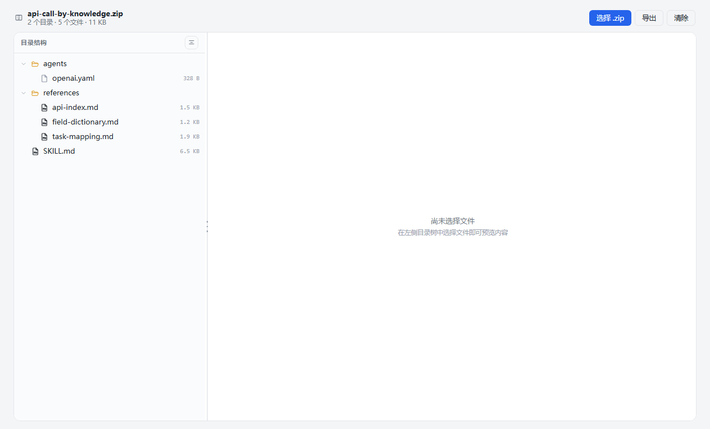
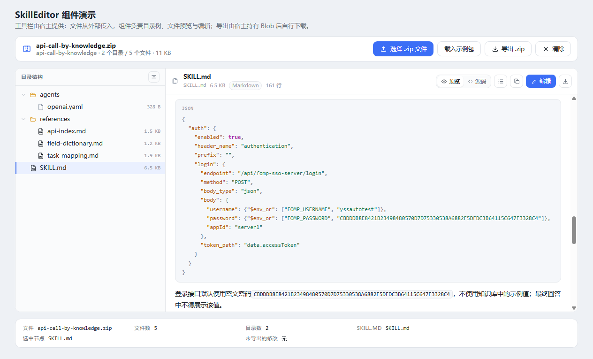
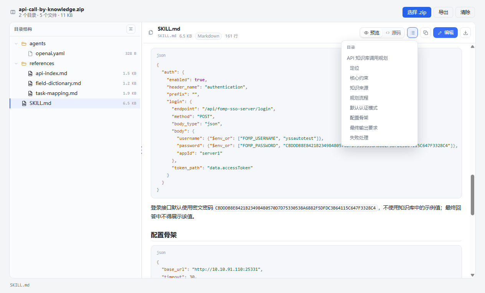
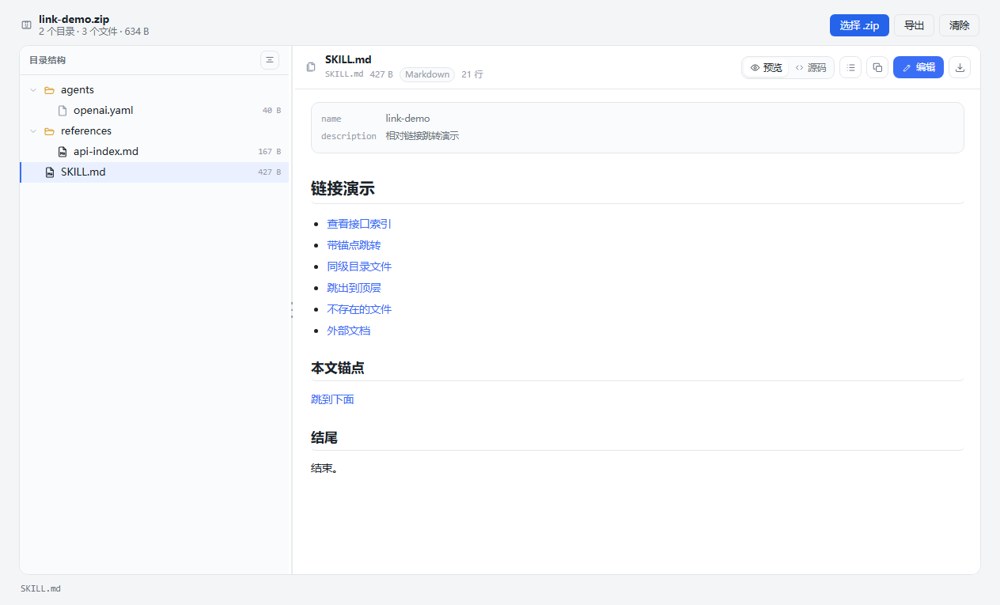
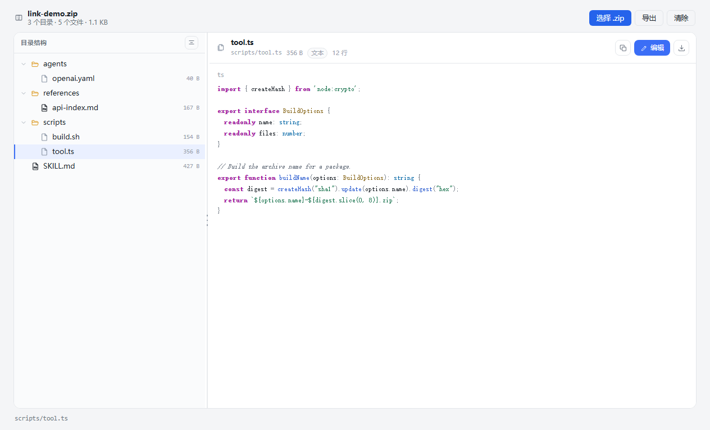
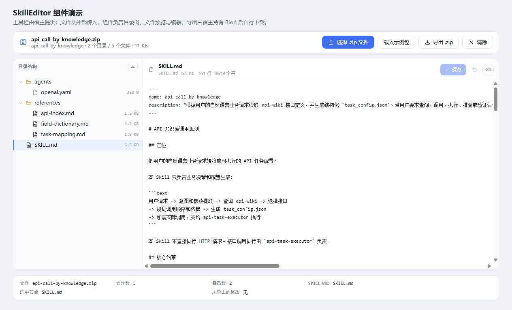
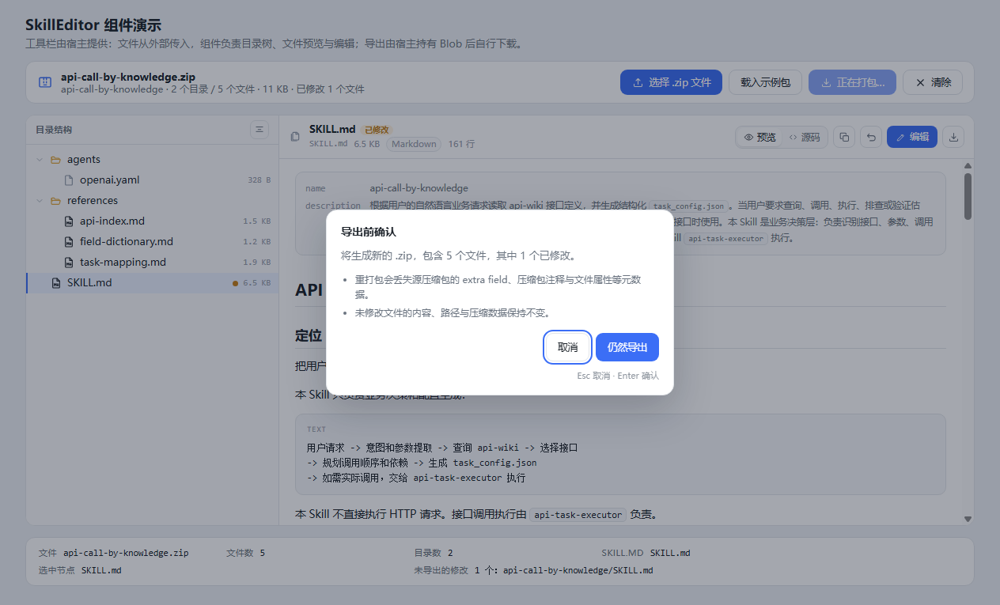

# @hp-future/skill-editor

[](LICENSE)
[](package.json)
[](https://github.com/hp-future/skill-editor)
[](#本地开发)

一个零运行时依赖的 React 组件：接收 `.zip` 技能包，左侧展示解压后的目录树，右侧预览文件内容，可选地编辑文本文件并把改动重新打包成新的 `.zip`。

文件始终由宿主传入——组件不提供任何文件选择入口，也不替宿主下载，边界清晰、便于嵌入已有页面。



## 特性

- **目录树**：解析 ZIP 中央目录后一次性建树，支持键鼠导航、单目录展开/收起、一键全展开（`Ctrl/⌘ + E`）与全收起（`Ctrl/⌘ + Shift + E`）以及 ARIA 树语义。
- **可拖拽分栏**：左右宽度默认取容器的 28%（约束在 200–400px），拖动分隔条、方向键或双击即可调整，窄容器自动改为上下堆叠。
- **文件预览**：Markdown 渲染、文本源码、图片内联，均带路径 / 体积 / 类型 / 行数信息，可复制内容、下载单个文件。
- **Markdown 渲染**：标题锚点、表格、任务列表、围栏代码块语法高亮（约 20 种语言族）、大纲跳转，以及**包内相对链接直达**（`references/x.md`、`./y.md`、`../SKILL.md`、`#锚点`）。
- **语法高亮**：不只作用于代码块，`.ts` / `.sh` 等约 40 种扩展名的独立文件同样着色，带语言标记与深浅色两套配色。
- **自定义预览**：`previewers` 按扩展名或自定义条件注册预览组件（字体、PDF、JSON 树……），组件负责读取字节并交出 `Blob`。
- **可编辑**：只改已有文本/Markdown 文件，显式保存、脏标记、切换保护、单文件撤销。
- **可导出**：`exportArchive()` 返回 `{ blob, fileName, stats, warnings }`，未改动条目按原始 DEFLATE 字节回写，保持逐字节一致。
- **依赖为零**：ZIP 读写基于 `DecompressionStream` / `CompressionStream` + 自带 CRC-32，不引入 jszip、unzipit 等运行时依赖。

## 安装

```bash
pnpm add @hp-future/skill-editor
# 或：npm install @hp-future/skill-editor
```

> 该包尚未发布到 npm（registry 目前返回 404）。发布前请按下文从仓库构建，再用本地路径引入。

React 18 / 19 为 peer 依赖，需由宿主提供；样式单独引入 `@hp-future/skill-editor/style.css`。

需要基于源码调试时，可克隆仓库后本地构建：

```bash
git clone https://github.com/hp-future/skill-editor.git
cd skill-editor
pnpm install
pnpm build        # 产出 dist/ 与 dist-types/
pnpm add file:../skill-editor  # 在你的项目里本地引用
```

## 快速开始

```tsx
import { useRef, useState } from 'react';
import { SkillEditor } from '@hp-future/skill-editor';
import type { SkillEditorHandle } from '@hp-future/skill-editor';
import '@hp-future/skill-editor/style.css';

export function Page() {
  const [file, setFile] = useState<File | null>(null);
  const ref = useRef<SkillEditorHandle>(null);

  return (
    <>
      <input
        type="file"
        accept=".zip,application/zip"
        onChange={(event) => setFile(event.target.files?.[0] ?? null)}
      />

      <SkillEditor ref={ref} source={file} />

      <button onClick={() => void ref.current?.exportArchive()}>导出</button>
    </>
  );
}
```

`source` 接受 `Blob` / `ArrayBuffer`，换新文件会自动重新解析；传 `null` 显示空状态。

## API

### `<SkillEditor />` Props

| 属性 | 类型 | 默认值 | 说明 |
| --- | --- | --- | --- |
| `source` | `Blob \| ArrayBuffer \| null` | — | 要展示的压缩包；为 `null` 时显示空状态 |
| `editable` | `boolean` | `false` | 是否允许编辑文本文件；关闭时不出现编辑入口 |
| `previewMode` | `'preview' \| 'placeholder'` | `'preview'` | `placeholder` 保留右侧空白，供宿主自绘 |
| `previewers` | `readonly FilePreviewer[]` | — | 按格式注册的自定义预览组件，见下文 |
| `renderFilePreview` | `(state, props) => ReactNode` | — | 整体替换预览内容（保留头部与操作） |
| `children` | `ReactNode` | — | 整体替换右侧窗格 |
| `onLoad` | `(result: SkillArchiveResult) => void` | — | 解析成功后回调，含树与 SKILL.md 概要 |
| `onError` | `(error: Error) => void` | — | 压缩包无法读取时回调 |
| `onSelectChange` | `(node: SkillTreeNode \| null) => void` | — | 选中节点变化 |
| `onEditChange` | `(summary: EditSummary) => void` | — | 已保存改动变化，宿主据此启用导出按钮 |
| `maxSizeBytes` | `number` | `100 MB` | 超过该体积直接拒绝解析 |
| `defaultExpandedDepth` | `number` | `1` | 初始展开层级 |
| `hideExpandToggle` | `boolean` | `false` | 隐藏树头部的展开/收起按钮 |
| `defaultTreeWidth` | `number` | 容器 28% | 目录树初始宽度（px），仍可拖拽调整 |
| `onTreeWidthChange` | `(width: number) => void` | — | 拖拽结束或键盘调整后回调最终宽度 |
| `emptyState` | `ReactNode` | — | 未载入压缩包时的占位内容 |
| `className` / `style` | `string` / `CSSProperties` | — | 作用于根元素 |

### Ref：`SkillEditorHandle`

| 方法 | 返回 | 说明 |
| --- | --- | --- |
| `reload()` | `void` | 重新解析当前 `source` |
| `getResult()` | `SkillArchiveResult \| null` | 已解析的压缩包信息 |
| `getDocument()` | `SkillDocument \| null` | 可编辑文档视图（改动集合） |
| `getSelectedPath()` | `string \| null` | 当前选中节点路径 |
| `setExpanded(path, expanded)` | `void` | 展开/收起指定目录 |
| `expandAll()` / `collapseAll()` | `void` | 全部展开 / 收起 |
| `hasUnsavedChanges()` | `boolean` | 是否存在未导出的改动 |
| `discardEdits()` | `void` | 丢弃全部改动（含草稿），不询问 |
| `exportArchive(options?)` | `Promise<ExportResult \| null>` | 重新打包；取消时返回 `null` |

`ExportResult` 形如：

```ts
{
  blob: Blob;              // 新的 .zip
  fileName: string;        // 例如 api-call-by-knowledge-edited.zip
  stats: { files: number; modified: number };
  warnings: string[];      // 例如「extra field 已丢失」
}
```

导出由宿主持有 Blob 后自行下载——组件不写文件系统。

## 自定义预览组件

内置预览只处理 Markdown / 文本 / 图片，其余显示「二进制内容，暂不支持预览」。通过 `previewers` 可以接管任意格式：

```tsx
import { SkillEditor, byExtension } from '@hp-future/skill-editor';

const fontPreviewer = {
  id: 'font',
  match: byExtension('ttf', 'otf', 'woff', 'woff2'),
  render: ({ info, bytes, blob, objectUrl }) => (
    <FontSpecimen name={info.name} size={info.size} url={objectUrl} />
  ),
};

<SkillEditor source={file} previewers={[fontPreviewer]} />;
```

| 约定 | 说明 |
| --- | --- |
| `match` | 收到 `{ path, name, extension, kind, size }`，先注册先匹配；抛错的匹配器会被跳过 |
| `render` | 载荷就绪后调用，参数为 `info` / `bytes`（原始字节）/ `blob`（MIME 已设置）/ `objectUrl`（切换文件自动回收） |
| 读取上限 | 被认领的文件即使原属「二进制」也会读入，上限 20 MB；超限仍走「文件过大」提示 |
| 优先级 | 命中的预览器 > `renderFilePreview` > 内置预览 |
| 状态 | 读取期间保留组件的 loading 提示，失败保留错误提示，只有 `ready` 时才渲染预览组件 |

演示页点「载入字体示例」会现场生成一个包含 `fonts/SkillDemo.ttf` 的技能包，可直接验证：


## Markdown 渲染

| 能力 | 说明 |
| --- | --- |
| 锚点目录 | 渲染视图头部出现「目录」按钮，按标题层级列出大纲，点击平滑滚动并短暂高亮 |
| 代码高亮 | 围栏代码块按语言着色；`.ts` / `.sh` 等独立文件同样着色，未识别语言保持纯文本 |
| 包内链接 | 相对链接切换到对应文件，`#锚点` 在当前文档内滚动；外部链接新标签打开；失效链接给出提示而不跳走 |









## 编辑与导出

| 能力 | 说明 |
| --- | --- |
| 可编辑范围 | **只改已有文本/Markdown 文件**；不支持新增、删除、重命名 |
| 保存模型 | **显式保存**：`Ctrl/⌘ + S` 或「保存」按钮；`Esc` 放弃草稿并退回预览 |
| 脏标记 | 树节点圆点 + 预览头部「已修改」+ `onEditChange` 计数 |
| 切换保护 | 草稿未保存时切换文件会确认：保存并切换 / 放弃并切换 / 取消 |
| 撤销 | 预览头部「撤销对该文件的修改」把该文件还原为压缩包原始内容 |
| 导出 | 未改动条目按原始 DEFLATE 字节回写，CRC 与内容逐字节一致；改动条目重新压缩 |





## 主题定制

所有颜色走 CSS 变量，默认配色随 `prefers-color-scheme` 切换深色主题。覆盖 `:root` 或组件根节点即可：

```css
.skill-editor-scope {
  --se-accent: #2f5fd0;
  --se-tree-width: 360px;
  --se-radius: 8px;
  --se-mono: 'JetBrains Mono', ui-monospace, monospace;
}
```

| 变量 | 用途 |
| --- | --- |
| `--se-bg` / `--se-surface` / `--se-surface-2` | 背景层级 |
| `--se-border` / `--se-border-strong` | 描边 |
| `--se-text` / `--se-text-muted` / `--se-text-faint` | 文本层级 |
| `--se-accent` / `--se-accent-soft` | 强调色（选中、链接、按钮） |
| `--se-danger` / `--se-danger-soft` | 错误与失效链接提示 |
| `--se-warn` / `--se-warn-soft` | 元数据丢失等警告 |
| `--se-folder` / `--se-markdown` / `--se-file` | 树图标配色 |
| `--se-code-*` | 语法高亮配色（comment / string / number / keyword / builtin / function / type / property / punctuation） |
| `--se-tree-width` | 目录树初始宽度（默认 `clamp(200px, 28%, 400px)`） |
| `--se-splitter-size` / `--se-radius` / `--se-mono` | 分隔条宽度、圆角与等宽字体 |

## 键盘快捷键

| 场景 | 快捷键 | 行为 |
| --- | --- | --- |
| 目录树 | `↑` `↓` | 上下移动焦点 |
| 目录树 | `→` / `←` | 展开或进入子目录 / 收起或回到父级 |
| 目录树 | `Home` / `End` | 跳到首行 / 末行 |
| 目录树 | `Enter` / `Space` | 选中当前行 |
| 分隔条 | `←` / `→` | 左右调整，每次 24px |
| 分隔条 | `Home` / `End` | 滚到最窄 / 最宽 |
| 分隔条 | `Enter` 或双击 | 恢复默认宽度 |
| 全局 | `Ctrl/⌘ + E` | 展开全部目录 |
| 全局 | `Ctrl/⌘ + Shift + E` | 收起全部目录 |
| 编辑器 | `Ctrl/⌘ + S` | 保存当前文件 |
| 编辑器 | `Esc` | 放弃草稿并退出编辑 |
| 对话框 | `Esc` | 取消并关闭 |

## 已知限制

- **元数据丢失**：重新打包会丢弃 extra field、压缩包注释、外部文件属性；导出前会弹出确认并在 `warnings` 中说明。
- **不合并、不追踪版本**：传入新的 `source` 会重置全部改动。
- **单条目上限**：ZIP64 的目录结构支持，但单个条目超过 4 GiB 会被拒绝。
- **预览上限**：文本 2 MB（超出截断并提示）、图片与自定义预览载荷各 20 MB。
- **格式支持**：仅 Markdown / 文本可编辑；其余格式只读（可通过 `previewers` 增强预览）。
- **布局**：分栏宽度不持久化，换页或重新挂载后回到默认比例（宿主可自行记住 `onTreeWidthChange` 的值）。

## 浏览器支持

依赖 `DecompressionStream` / `CompressionStream` 与 ES2022 语法，支持当前主流常青浏览器：

| 浏览器 | 最低版本 |
| --- | --- |
| Chrome / Edge | 80+ |
| Firefox | 113+ |
| Safari | 16.4+ |

不支持时会通过 `onError` 给出可读错误，而不是静默失败。

## 本地开发

```bash
pnpm install
pnpm dev        # 演示页 http://localhost:5173
pnpm test       # 单元测试 + 组件测试
pnpm typecheck  # tsc --noEmit
pnpm build      # 产出 dist/ 组件包 + dist-types/ 类型声明
```

不强制使用 pnpm：`npm install` 后用 `npm run dev` / `npm test` / `npm run build` 等价，yarn 同理。仓库以 `pnpm-lock.yaml` 为准，提交时请勿附带 `package-lock.json` 或 `yarn.lock`。

演示页（`src/demo`）自带宿主工具栏：选择 `.zip`、载入示例包、载入字体示例、导出、清除。

```
src/
├── components/SkillEditor/   # 组件本体（SkillEditor、FileTree、FilePreview、FileEditor…）
├── lib/
│   ├── zip/                  # ZIP 解析（zipArchive）与写入（zipWriter、crc32）
│   ├── document/             # 改动集合与重新打包（SkillDocument）
│   ├── markdown.tsx          # Markdown 渲染器（含锚点注册）
│   ├── highlight.ts          # 词法高亮（代码块与整文件共用）
│   ├── linkTarget.ts         # 包内链接解析
│   └── skillTree.ts          # 目录树构建
├── demo/                     # 演示页与示例包
└── test/                     # Vitest 测试
```

## 贡献

欢迎 issue 与 PR：

1. Fork 并基于 `main` 开分支；
2. 补充或更新对应测试（`pnpm test`），保持 `pnpm typecheck` 与 `pnpm build` 通过；
3. 提交信息遵循 Conventional Commits（如 `feat: 支持 ...`、`fix: 修正 ...`）；
4. PR 描述里说明动机、行为变化与验证方式。

代码风格由 Prettier 约束（`npx prettier --write .`，pnpm 下等价于 `pnpm dlx prettier --write .`），不引入新的运行时依赖。

## 许可证

基于 [MIT](LICENSE) 许可发布。

## 更新日志

见 [CHANGELOG.md](CHANGELOG.md)。
